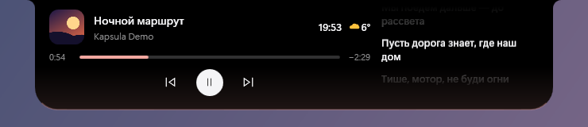
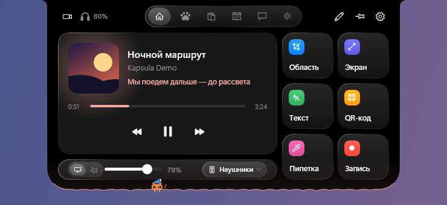
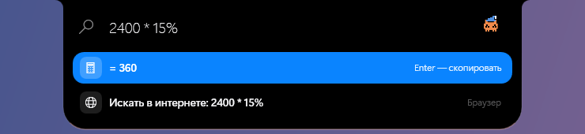
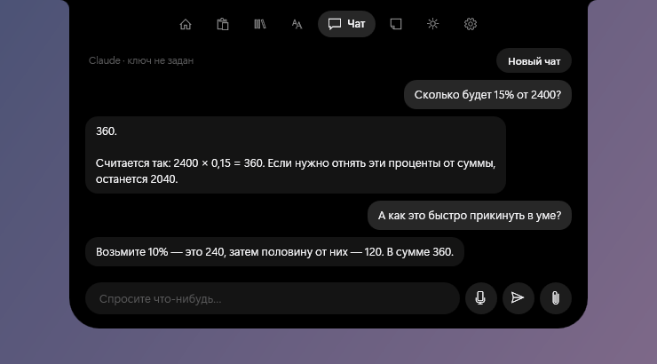
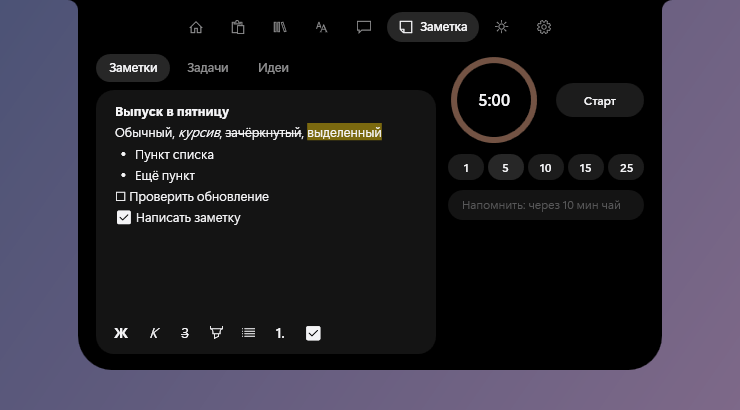
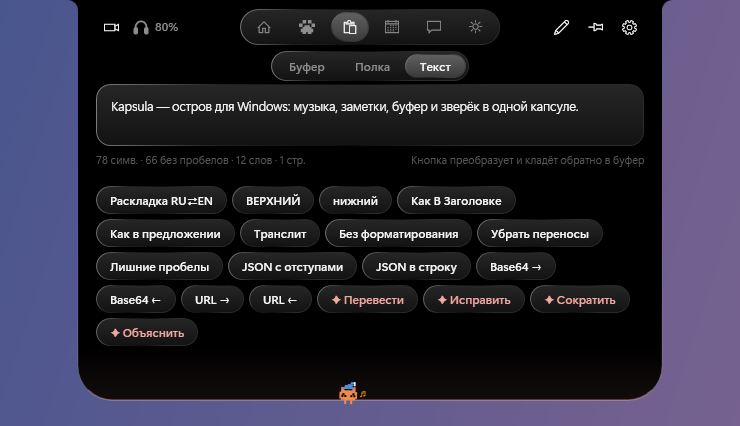
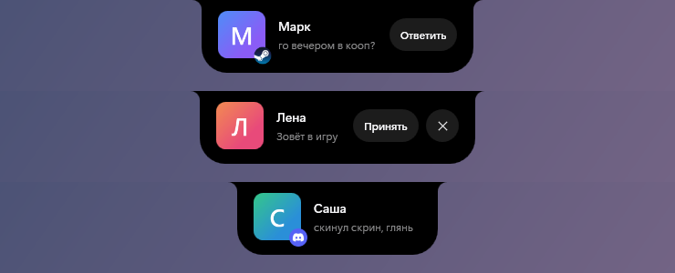
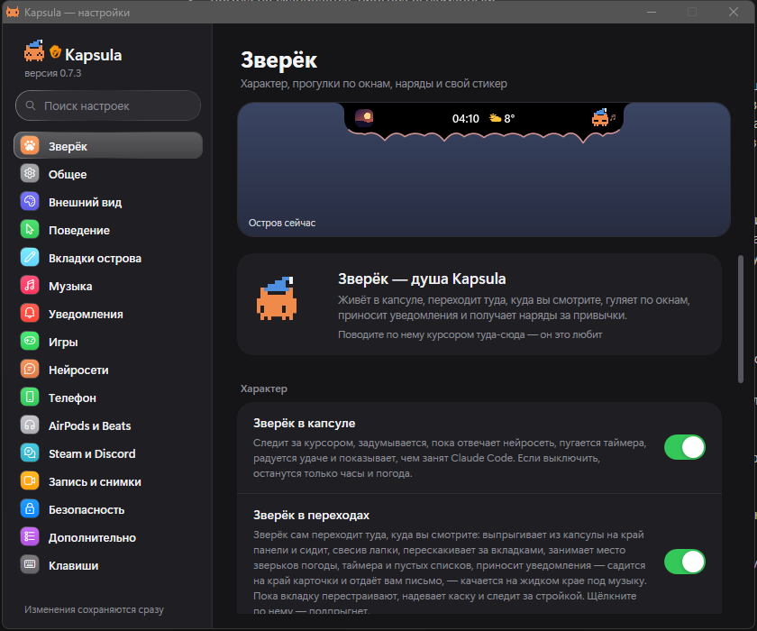

# Kapsula

«Остров» для Windows в духе выреза на MacBook: маленькая капсула у верхнего края экрана, которая раскрывается в панель с музыкой, буфером обмена, заметками, погодой и другими мелочами.

> **Ранняя альфа.** Всё может ломаться и меняться. Проверялось на одном компьютере с Windows 11.






| Командная строка | Чат с Claude |
|---|---|
|  |  |

| Заметки и таймер | Работа с текстом |
|---|---|
|  |  |



<details>
<summary>Настройки</summary>



</details>

## Что умеет

- **Музыка** — обложка, управление, перемотка, «жидкий» край, который пляшет как эквалайзер (слева бас, справа верха), тексты песен (lrclib.net). Если играют несколько программ, можно выбрать, какую показывать, и менять громкость только плеера.
- **«Главная» под себя** — уберите плеер, лишние плитки, громкость или ряд программ, и остров перестроится и станет меньше.
- **Зверёк в капсуле** — пиксельный питомец: следит за курсором, задумывается, пока отвечает нейросеть, пугается таймера, радуется удаче и показывает, чем занят Claude Code.
- **Буфер обмена и полка** — история скопированного, перетаскивание файлов «на потом».
- **Снимки экрана** — выделение области, разметка, распознавание текста, чтение QR-кодов.
- **Запись экрана** — без звука, со звуком компьютера или вместе с микрофоном (нужен [ffmpeg](https://ffmpeg.org/)).
- **Командная строка** — запуск программ, поиск файлов по имени, калькулятор, единицы, таймеры, напоминания.
- **Погода** с приборами на плитках (компас ветра, давление, путь солнца), **заметки**, **Wi-Fi и Bluetooth**, громкость и яркость.
- **Чат с нейросетью** — Claude или Gemini на выбор, по вашему ключу API (у Gemini есть бесплатный уровень). Ключ хранится только на вашем компьютере в зашифрованном виде.
- **Наушники** — заряд AirPods и Beats в панели и при подключении, предупреждение о низком заряде. Наушники сами сообщают заряд по Bluetooth; Kapsula только слушает.
- **Матовое стекло** — раскрытая панель полупрозрачная, фон за ней размыт (включается в настройках).
- **Календарь, помодоро, быстрые заметки, «Не беспокоить», история уведомлений** — команды в строке острова: `календарь`, `помодоро`, `заметка …`, `тихо`, `уведомления`.
- **Claude Code** — когда он просит разрешение, а вы в другой программе, на острове появляется карточка «Разрешить / Всегда / Отклонить»; вопросы с вариантами приходят кнопками; когда он закончил, видно начало ответа и можно написать ему прямо с острова; остановить его можно из значка у часов или командой «стоп claude». Подключается кнопкой в настройках: Kapsula дописывает четыре http-хука в `~/.claude/settings.json` (прежний файл сохраняется рядом). Запросы идут только на этот компьютер (порт 42072) и подписаны случайной меткой.
- **Steam** — игры в командной строке, карточка «игра готова» после загрузки, время игровой сессии. Читается из папки Steam, без входа в аккаунт.
- **Уведомления Steam** — сообщения друзей, «друг в игре» и другие всплывающие уведомления карточками на острове. Нужен [Millennium](https://steambrew.app/) (неофициальная модификация клиента Steam): в настройках Kapsula нажмите «Подключить», затем включите плагин Kapsula в Millennium. Плагин передаёт уведомления только на этот компьютер (порт 42071); исходник — в [integrations/millennium](integrations/millennium).
- **Discord** — сообщения и звонки карточками, если у вас стоит [Vencord](https://vencord.dev/) и в нём включён плагин XSOverlay. Kapsula только принимает уведомления на локальном порту 42070 и ничего не меняет в Discord. Vencord — неофициальная модификация клиента; ставить её или нет, решаете вы.
- **Игры и видео на весь экран** — остров прячется и выглядывает только на смену трека и уведомления.
- **Таймер** — когда время вышло, край острова «ощетинивается» иглами и дрожит, пока таймер не остановят.
- **Настройки с превью** — в окне настроек видна живая копия острова, главной панели и мини-плеера: изменения видно сразу.
- **Темы, размер, автоскрытие**, поддержка мониторов с высокой частотой обновления.

## Установка

1. Скачайте `Kapsula.exe` со страницы [Releases](../../releases).
2. Положите файл в папку, куда у вас есть право записи (например `%LOCALAPPDATA%\Kapsula`) — иначе не сработает автообновление.
3. Запустите. Windows покажет предупреждение SmartScreen «неизвестный издатель»: у файла нет платной цифровой подписи. «Подробнее» → «Выполнить в любом случае».

Нужна Windows 10 или 11 (x64). .NET Framework 4.8 в них уже есть.

## Автообновление

Раз в час Kapsula запрашивает у GitHub список релизов этого репозитория. Если вышла версия новее, она скачивает `Kapsula.exe`, сверяет контрольную сумму SHA-256, подменяет свой файл и сама перезапускается, когда вы пару минут не трогаете компьютер (и не идёт запись экрана или таймер). Выключается в настройках («Автообновление»).

## Что уходит в сеть

Kapsula не собирает статистику и никуда не отправляет ваши данные. Запросы делаются только ради конкретных функций:

| Куда | Зачем | Когда |
|---|---|---|
| api.github.com, github.com | проверка и загрузка обновлений | если включено автообновление |
| open-meteo.com | погода (передаются координаты выбранного города) | если открыта погода |
| lrclib.net | тексты песен (название и исполнитель трека) | если включены тексты |
| api.anthropic.com | чат с Claude (ваши сообщения) | только если вы ввели ключ и пишете в чат |
| generativelanguage.googleapis.com | чат с Gemini (ваши сообщения) | только если вы выбрали Gemini, ввели ключ и пишете в чат |

Чтобы край плясал как эквалайзер, Kapsula слушает звук, который играет на компьютере. Он разбирается на частоты в памяти и никуда не сохраняется и не передаётся.

Настройки и заметки лежат в `%APPDATA%\Kapsula`.

## Сборка из исходников

Ничего устанавливать не нужно — используется компилятор C#, встроенный в Windows:

```powershell
powershell -ExecutionPolicy Bypass -File build.ps1
powershell -ExecutionPolicy Bypass -File tests.ps1
```

## Выпуск новой версии

1. Поднять номер в `version.txt` (например `0.1.1`) и закоммитить.
2. Поставить тег `v0.1.1` и отправить его на GitHub.
3. GitHub Actions соберёт `Kapsula.exe` и создаст релиз; у пользователей он подтянется сам.

## Лицензия

[MIT](LICENSE)
